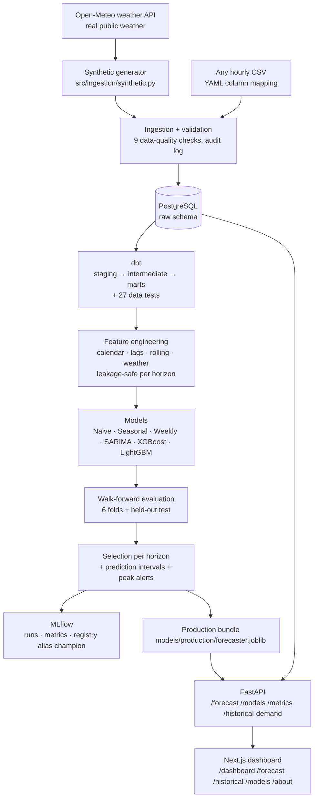

# Nouakchott Energy Demand Forecasting

End-to-end platform prototype for forecasting hourly electricity demand in Nouakchott, Mauritania.
It covers ingestion and data validation, a PostgreSQL warehouse, dbt transformations, leakage-safe
feature engineering, baseline/statistical/ML models, temporal validation, prediction intervals,
peak-demand alerts, MLflow tracking and registry, a FastAPI service and a Next.js dashboard. The
whole stack runs with Docker Compose.

> [!IMPORTANT]
> **This prototype does not use SOMELEC data.** It runs on **synthetic** demand data, optionally
> driven by **real public weather** from Open-Meteo. It is not affiliated with or endorsed by
> SOMELEC, and no figure here describes real consumption in Nouakchott. See
> [Prototype data](#prototype-data) and [SOMELEC Data Integration](#somelec-data-integration).

---

## Contents

[Problem](#problem) · [Business Context](#business-context) · [Objectives](#objectives) ·
[Architecture](#architecture) · [Dataset](#dataset) · [Methodology](#methodology) ·
[Feature Engineering](#feature-engineering) · [Models](#models) · [Evaluation](#evaluation) ·
[Results](#results) · [API](#api) · [Dashboard](#dashboard) · [MLOps](#mlops) ·
[Installation](#installation) · [Usage](#usage) · [Docker](#docker) ·
[Project Structure](#project-structure) · [Limitations](#limitations) ·
[Future Work](#future-work) · [SOMELEC Data Integration](#somelec-data-integration)

## Problem

> *What will electricity demand in Nouakchott be over the next hours and days?*

The system produces:

| Output | How |
|---|---|
| Forecasts at **1 h, 6 h, 24 h and 7 days** | One direct model per horizon bucket, chosen on validation performance |
| **Uncertainty intervals** (lower / forecast / upper) | Empirical quantiles of out-of-sample errors, with coverage measured on a held-out period |
| **High-demand period detection** | Trailing-percentile threshold with LOW / MEDIUM / HIGH risk levels (experimental) |

## Business Context

In a hot coastal city, demand depends strongly on the weather: air-conditioning load rises with
temperature and humidity. It also follows daily and weekly cycles, and it grows over time. Reliable
short-term forecasts can help a grid operator to:

- anticipate consumption peaks and high-load periods;
- plan production and dispatch, and improve day-ahead planning;
- analyse how demand evolves over time.

This repository is a **technical prototype** meant to show what such a system could look like and to
support a request for access to real data. It makes no claims about how any operator currently works.

## Objectives

1. A reproducible data platform where **data sources can be swapped without code changes**.
2. **Leakage-free** features and **chronological validation**: no random split, ever.
3. **Model choice based on measured performance** against strong baselines, never on complexity.
4. Honest uncertainty: intervals are **calibrated and checked**, not assumed.
5. Production-style serving (**API + dashboard**) with experiments tracked in **MLflow**.
6. Every result in this README is **generated by the pipeline**.

## Architecture



Docker Compose services: `postgres`, `mlflow`, `api`, `frontend`, plus an optional `pipeline` batch
job (profile) that runs generate → load → dbt → train inside Docker. Airflow was deliberately left
out of this version (see [Future Work](#future-work)).

## Dataset

### Prototype data

> [!WARNING]
> **The data in this prototype is synthetic.** It is not SOMELEC data and is not calibrated on real
> consumption measurements. It exists only to demonstrate the architecture and the methodology.

| Source | Type | What is real? |
|---|---|---|
| `synthetic` (default) | [src/ingestion/synthetic.py](src/ingestion/synthetic.py) | Nothing. Demand and weather are simulated. Offline and reproducible (seed 42). |
| `synthetic` + `--weather open-meteo` | Generator driven by observed weather | **Weather is real** (Open-Meteo historical reanalysis for Nouakchott, CC BY 4.0). **Demand is still synthetic.** |
| Any hourly CSV (e.g. [OPSD](configs/sources/opsd_example.yaml)) | Public load data via a YAML mapping | Real load, but **not Mauritanian**. Only useful for testing the pipeline on real-world signals. |

No public hourly demand dataset for Nouakchott is known to the author. That is why the pipeline is
built so that a real dataset can be plugged in just by adding a mapping file.

**What the generator simulates** (multiplicative model; every parameter is in `SyntheticConfig`):

- **hourly cycle**: night trough around 04:00, midday plateau, evening peak around 20:00–21:00;
- **weekly cycle**: lower demand on the Saturday–Sunday weekend, plus a dip at Friday prayer time;
- **annual / monthly cycle**: seasonal climate plus a small dip in the summer holidays;
- **trend**: about 5 %/year growth (an assumption);
- **weather**: approximate Nouakchott climatology (hot, humid season May–October; mild, dry, windy
  season December–March), diurnal cycle, afternoon sea breeze and multi-day **heatwaves**;
- **cooling load**: a non-linear response to temperature, smoothed for the thermal inertia of
  buildings and amplified by humidity;
- **noise**: AR(1) plus white noise;
- **events**, logged as ground truth in `raw.synthetic_events`: **demand surges**, **load shedding**
  (served demand drops) and **meter glitches**.

As a sanity check on the climate assumptions, the monthly mean temperatures of the real Open-Meteo
data for 2023–2026 (22.6 °C in January to 29.9 °C in October) are close to the synthetic
climatology.

Default dataset: **3 years of hourly data** (2023-09-01 → 2026-08-31, 26,304 rows):

| Column | Unit |
|---|---|
| `timestamp` | UTC (= Nouakchott local time: UTC+0, no DST) |
| `demand_mw` | MW (hourly average load) |
| `temperature_c` | °C |
| `humidity` | % relative humidity |
| `wind_speed` | m/s |
| `cloud_cover` | % |

### Data quality checks

Every load goes through [src/ingestion/validation.py](src/ingestion/validation.py). Each run is
audited in `raw.ingestion_runs`, together with its full validation report (JSONB).

| Check | Severity |
|---|---|
| Required columns · parseable timestamps · duplicate timestamps · hourly frequency | error |
| Negative values · physical bounds | error |
| Missing hours (gaps) · null values | warning |
| Demand outliers (robust z-score against the same hour on neighbouring days) | warning |

Error-level failures block the load (unless `--force` is passed). Outliers are **reported, not
removed**, because a spike can be a real event. On the synthetic data, the outlier check recovers
19/20 injected meter glitches and 38/45 load-shedding events (see the EDA notebook).

### Exploratory analysis

[notebooks/01_eda.ipynb](notebooks/01_eda.ipynb) (executed, reads from PostgreSQL) covers the demand
trend, the hourly / weekly / monthly profiles, the hour × month heatmap, the distribution, ACF and
MSTL decomposition, the weather relationships, peaks and anomalies. Every chart is labelled as
synthetic. Key findings that shaped the modelling: lags 1–3, 24 and 168 dominate the autocorrelation;
hourly weather correlations are confounded by the daily cycle; and a growing trend biases fixed
peak thresholds, hence the trailing-window threshold used later.

## Methodology

### Direct multi-horizon strategy

There is one model per **horizon bucket** H ∈ {1, 6, 24, 168} hours. The bucket-H model predicts
demand at time *t* from information available at *t − H*. To forecast lead time *k* from origin *T*,
the system uses the smallest bucket H ≥ *k*: lead 1 → H1, leads 2–6 → H6, 7–24 → H24, 25–168 → H168.
There is no recursion, so errors don't compound through fed-back predictions, and a 7-day forecast
really is a 7-day forecast. Horizons live in `TrainingConfig.horizons`.

### Anti-leakage rule

> For a horizon-H model and target time *t*, every feature derived from observations uses only data
> with timestamp ≤ *t − H*. Only deterministic calendar information about *t* is allowed.

This is enforced mechanically: every observed series is `shift(k ≥ H)`-ed **before** any rolling
window. It is also *tested*: `tests/test_features.py` corrupts every observation after an origin and
checks that no feature available at that origin changes, for all four horizons. A companion test
confirms the check does detect leakage when "oracle" future weather is switched on.

### Why not a random split

Hourly demand is strongly autocorrelated (lag-1 ACF ≈ 0.93). With a random split, the hours on both
sides of every test hour end up in training and lag features overlap training targets. On top of
that, the upward trend would let the model see *future* demand levels. The scores would be
optimistic and meaningless for forecasting.

### Validation scheme

```
|------------------------- development (≈ 2.75 years) --------------------------|--- test ---|
|== train ==>| fold 1 (60 d) |                                                     last 92 days
|====== train ======>| fold 2 |                                                    (reported once,
...                                                                                  never used for
|=============== train ===============>| fold 6 |                                   any decision)
```

- **6 expanding-window folds of 60 days** covering the full year before the test period, so selection
  and interval calibration see every season.
- **Purge**: for horizon H, training targets end at `fold_start − H`.
- **Selection** uses pooled cross-validation MAE only. A simpler model (baseline < statistical < ML)
  is preferred when it is within 1 % of the best.
- **Test** (last 92 days): every candidate is refitted on all development data and scored once. This
  is for reporting only.
- **Production**: the selected model is refitted on all data.

## Feature Engineering

[src/features/](src/features/) builds the features in Python for every horizon. dbt computes the
calendar features and reference lags in SQL, and a parity test checks that both implementations
agree.

| Group | Features |
|---|---|
| Calendar | `hour`, `day_of_week`, `day_of_month`, `week_of_year`, `month`, `quarter`, `is_weekend`, sin/cos of hour and day-of-year |
| Local context | `is_friday`, `is_friday_prayer` (Mauritanian weekend = Sat–Sun) |
| Local calendar (**off by default**) | `is_holiday`, `is_ramadan`, `is_eid`, `is_school_holiday`, from [dbt/seeds/local_calendar.csv](dbt/seeds/local_calendar.csv); enable via `FeatureConfig.local_flags` |
| Demand lags (k ≥ H) | `demand_lag_1, 2, 3, 6, 12, 24, 48, 72, 168` (+ `336`) |
| Rolling (windows end at *t − H*) | `rolling_mean_6h, 12h, 24h, 48h, 7d`, `rolling_std_24h`, `rolling_max_24h`, `rolling_min_24h`, `same_hour_ratio` |
| Weather known at the origin | last observed temperature, same hour on the latest known day, 24 h mean/max, cooling degrees (24 h / 72 h), humidity, wind, cloud |

The local calendar flags are disabled because the synthetic data doesn't simulate those effects,
and because the Islamic-calendar dates in the seed are **approximate** (`verified=false`, ±1 day
depending on moon sighting). Fixed-date public holidays are marked `verified=true`.

`use_future_weather=True` adds weather *at the target time*, which assumes a perfect weather
forecast. It's an upper-bound experiment, not the deployed configuration.

## Models

| Family | Model | Definition |
|---|---|---|
| Baseline | Naive | `ŷ(t) = y(t − H)`, i.e. `y(t − 1)` for H = 1 |
| Baseline | Seasonal naive | `ŷ(t) = y(t − 24·⌈H/24⌉)`, i.e. `y(t − 24)` for H ≤ 24 |
| Baseline | Weekly seasonal naive | `ŷ(t) = y(t − 168)` |
| Statistical | SARIMA(1,0,1)(0,1,1)₂₄ + weekly Fourier terms | Fitted on a trailing 6-week window. H-step forecasts for *every* origin come from the Kalman filtered states, `ŷ(o+H) = d + Z·Tᴴ·a(o\|o)`: exact and causal, verified against statsmodels' `forecast()` in the tests |
| ML | XGBoost | Gradient-boosted trees on all features, fixed conservative hyper-parameters |
| ML | LightGBM | Same features, fixed conservative hyper-parameters |

The tree models learn `demand / rolling_mean_7d`, where the weekly level is known at the origin,
and scale the prediction back. Trees can't extrapolate a level they have never seen, and demand
grows every year. Code: [src/models/](src/models/) (`base.py`, `baseline.py`, `sarima_model.py` →
`statistical/sarima.py`, `xgboost_model.py`, `lightgbm_model.py`, `intervals.py`, `bundle.py`).

## Evaluation

`evaluate_model()` ([src/evaluation/metrics.py](src/evaluation/metrics.py)) returns MAE, RMSE,
MAPE, sMAPE, bias and n. **MAE is the selection metric** because it is robust and expressed in MW.
Every metric is **H-step-ahead**: each target hour is forecast from information available H hours
earlier.

**Prediction intervals** ([src/models/intervals.py](src/models/intervals.py)): empirical 5 % / 95 %
quantiles of the *relative* out-of-sample CV errors of the selected model, computed separately for
four 6-hour blocks of the day. The band scales with the demand level. Limitations: coverage is only
approximate and assumes future errors look like past ones. The intervals are per hour, not for a
whole path, and they are **not guarantees**. Empirical coverage on the test period is reported below.

**Peak detection** ([src/peaks/detector.py](src/peaks/detector.py), **experimental**): the threshold
is the P95 of observed demand over the trailing 365 days. The trailing window matters because, with
growth, a full-history percentile would flag most recent hours. Risk is **HIGH** if the forecast is
≥ the threshold, **MEDIUM** if only the upper bound reaches it, **LOW** otherwise. This threshold is
a statistical convention, **not an official SOMELEC rule**. Precision and recall of the alerts on the
test period are reported below.

## Results

<!-- RESULTS:START -->
_Generated automatically from `reports/metrics.json` — training run of 2026-09-24T14:35:42 UTC, dataset `synthetic` version `1f1a895d7359` (26,304 hourly rows, 2023-09-01 → 2026-08-31)._

> ⚠️ These metrics are measured on **synthetic data**. They validate the pipeline and the methodology; they are **not** an estimate of accuracy on real Nouakchott demand.

- **Cross-validation (model selection)**: 6 expanding-window folds of 60 days, 2025-06-06 → 2026-05-31.
- **Held-out test (reporting only)**: 2026-06-01 → 2026-08-31. Models are refitted on all development data, then scored once.
- Metrics are *H-step-ahead*: each target hour is forecast from information available H hours earlier.

### Selected model per horizon

| Horizon | Selected (CV MAE) | Test MAE (MW) | Test RMSE (MW) | Test MAPE (%) | Best baseline test MAE | 90 % interval coverage (test) | Mean interval width (MW) |
|---|---|---:|---:|---:|---:|---:|---:|
| 1 hour | SARIMA | 3.14 | 4.73 | 1.60 | 8.52 (Naive) | 91.8 % | 13.2 |
| 6 hours | LightGBM | 6.17 | 8.33 | 3.08 | 10.66 (Seasonal Naive) | 88.4 % | 22.5 |
| 24 hours | LightGBM | 8.44 | 11.73 | 4.14 | 10.66 (Naive) | 84.4 % | 26.4 |
| 7 days (168 h) | LightGBM | 10.98 | 15.18 | 5.33 | 12.16 (Naive) | 81.1 % | 31.7 |

### Horizon: 1 hour

**Cross-validation (pooled out-of-sample, used for selection)**

| Model | MAE (MW) | RMSE (MW) | MAPE (%) | sMAPE (%) | Bias (MW) |
|---|---:|---:|---:|---:|---:|
| **SARIMA** ✅ | 3.16 | 5.32 | 1.73 | 1.72 | -0.31 |
| LightGBM | 3.67 | 5.66 | 1.99 | 1.98 | -1.15 |
| XGBoost | 3.96 | 6.31 | 2.13 | 2.13 | -1.31 |
| Naive | 7.96 | 10.66 | 4.39 | 4.34 | 0.00 |
| Weekly Seasonal Naive | 8.72 | 12.25 | 4.71 | 4.68 | 0.02 |
| Seasonal Naive | 9.05 | 12.23 | 4.93 | 4.92 | 0.06 |

**Held-out test period**

| Model | MAE (MW) | RMSE (MW) | MAPE (%) | sMAPE (%) | Bias (MW) |
|---|---:|---:|---:|---:|---:|
| **SARIMA** ✅ | 3.14 | 4.73 | 1.60 | 1.59 | -0.30 |
| XGBoost | 4.03 | 6.16 | 1.99 | 2.00 | -1.54 |
| LightGBM | 4.06 | 6.14 | 2.00 | 2.01 | -1.57 |
| Naive | 8.52 | 10.99 | 4.39 | 4.35 | -0.03 |
| Seasonal Naive | 10.66 | 14.09 | 5.38 | 5.40 | -0.90 |
| Weekly Seasonal Naive | 12.16 | 16.23 | 6.03 | 6.08 | -2.06 |

Peak alerts on test (threshold P95 of the trailing 365 days = 231.5 MW, 319 actual peak hours): HIGH precision 93 % / recall 87 %; HIGH+MEDIUM precision 72 % / recall 98 %.

### Horizon: 6 hours

**Cross-validation (pooled out-of-sample, used for selection)**

| Model | MAE (MW) | RMSE (MW) | MAPE (%) | sMAPE (%) | Bias (MW) |
|---|---:|---:|---:|---:|---:|
| **LightGBM** ✅ | 5.60 | 7.91 | 3.05 | 3.06 | -2.51 |
| SARIMA | 5.82 | 8.50 | 3.16 | 3.14 | -0.71 |
| XGBoost | 5.97 | 8.39 | 3.25 | 3.27 | -2.80 |
| Weekly Seasonal Naive | 8.72 | 12.25 | 4.71 | 4.68 | 0.02 |
| Seasonal Naive | 9.05 | 12.23 | 4.93 | 4.92 | 0.06 |
| Naive | 32.97 | 39.96 | 19.15 | 18.11 | 0.02 |

**Held-out test period**

| Model | MAE (MW) | RMSE (MW) | MAPE (%) | sMAPE (%) | Bias (MW) |
|---|---:|---:|---:|---:|---:|
| **LightGBM** ✅ | 6.17 | 8.33 | 3.08 | 3.11 | -3.04 |
| SARIMA | 6.18 | 8.35 | 3.13 | 3.15 | -1.22 |
| XGBoost | 6.49 | 8.91 | 3.23 | 3.27 | -3.37 |
| Seasonal Naive | 10.66 | 14.09 | 5.38 | 5.40 | -0.90 |
| Weekly Seasonal Naive | 12.16 | 16.23 | 6.03 | 6.08 | -2.06 |
| Naive | 35.79 | 42.93 | 19.52 | 18.46 | -0.27 |

Peak alerts on test (threshold P95 of the trailing 365 days = 231.5 MW, 319 actual peak hours): HIGH precision 94 % / recall 68 %; HIGH+MEDIUM precision 57 % / recall 95 %.

### Horizon: 24 hours

**Cross-validation (pooled out-of-sample, used for selection)**

| Model | MAE (MW) | RMSE (MW) | MAPE (%) | sMAPE (%) | Bias (MW) |
|---|---:|---:|---:|---:|---:|
| **LightGBM** ✅ | 6.73 | 9.24 | 3.63 | 3.65 | -3.13 |
| XGBoost | 6.82 | 9.36 | 3.68 | 3.71 | -3.17 |
| SARIMA | 7.00 | 9.91 | 3.77 | 3.76 | -0.92 |
| Weekly Seasonal Naive | 8.72 | 12.25 | 4.71 | 4.68 | 0.02 |
| Naive | 9.05 | 12.23 | 4.93 | 4.92 | 0.06 |
| Seasonal Naive | 9.05 | 12.23 | 4.93 | 4.92 | 0.06 |

**Held-out test period**

| Model | MAE (MW) | RMSE (MW) | MAPE (%) | sMAPE (%) | Bias (MW) |
|---|---:|---:|---:|---:|---:|
| **LightGBM** ✅ | 8.44 | 11.73 | 4.14 | 4.24 | -4.99 |
| XGBoost | 8.55 | 12.07 | 4.16 | 4.27 | -5.41 |
| SARIMA | 8.57 | 11.95 | 4.21 | 4.27 | -2.75 |
| Naive | 10.66 | 14.09 | 5.38 | 5.40 | -0.90 |
| Seasonal Naive | 10.66 | 14.09 | 5.38 | 5.40 | -0.90 |
| Weekly Seasonal Naive | 12.16 | 16.23 | 6.03 | 6.08 | -2.06 |

Peak alerts on test (threshold P95 of the trailing 365 days = 231.5 MW, 319 actual peak hours): HIGH precision 92 % / recall 52 %; HIGH+MEDIUM precision 51 % / recall 93 %.

### Horizon: 7 days (168 h)

**Cross-validation (pooled out-of-sample, used for selection)**

| Model | MAE (MW) | RMSE (MW) | MAPE (%) | sMAPE (%) | Bias (MW) |
|---|---:|---:|---:|---:|---:|
| **LightGBM** ✅ | 7.74 | 10.55 | 4.16 | 4.18 | -2.45 |
| XGBoost | 7.96 | 10.87 | 4.27 | 4.31 | -2.97 |
| SARIMA | 8.07 | 11.23 | 4.33 | 4.30 | -0.27 |
| Naive | 8.72 | 12.25 | 4.71 | 4.68 | 0.02 |
| Seasonal Naive | 8.72 | 12.25 | 4.71 | 4.68 | 0.02 |
| Weekly Seasonal Naive | 8.72 | 12.25 | 4.71 | 4.68 | 0.02 |

**Held-out test period**

| Model | MAE (MW) | RMSE (MW) | MAPE (%) | sMAPE (%) | Bias (MW) |
|---|---:|---:|---:|---:|---:|
| SARIMA | 10.88 | 15.28 | 5.24 | 5.46 | -8.60 |
| **LightGBM** ✅ | 10.98 | 15.18 | 5.33 | 5.53 | -7.11 |
| XGBoost | 11.04 | 15.39 | 5.36 | 5.57 | -7.33 |
| Naive | 12.16 | 16.23 | 6.03 | 6.08 | -2.06 |
| Seasonal Naive | 12.16 | 16.23 | 6.03 | 6.08 | -2.06 |
| Weekly Seasonal Naive | 12.16 | 16.23 | 6.03 | 6.08 | -2.06 |

Peak alerts on test (threshold P95 of the trailing 365 days = 231.5 MW, 319 actual peak hours): HIGH precision 86 % / recall 39 %; HIGH+MEDIUM precision 44 % / recall 83 %.
<!-- RESULTS:END -->

### Reading the results

These observations come from the run above (synthetic data):

- **Every selected model beats the best baseline at every horizon on the held-out test.** The gain
  shrinks as the horizon grows, as expected: less recent information is available.
- **The simplest adequate model wins.** At 1 h, SARIMA beats both gradient-boosting models. At 6 h,
  24 h and 7 days, LightGBM, XGBoost and SARIMA end up close to each other.
- **Selection is made on cross-validation, not on the test set.** At 7 days SARIMA is marginally
  better than the selected LightGBM *on test*. Because the choice was fixed on CV beforehand, this is
  reported rather than "fixed", which is what keeps the test score an unbiased estimate.
- **Baselines must be horizon-aware.** A naive forecast 6 hours ahead (`y(t−6)`) is very poor
  because it lands on the other side of the daily cycle, while seasonal naive holds up.
- **Interval calibration degrades with the horizon.** Coverage is close to nominal at 1 h, but falls
  below 90 % at longer horizons. The test period is the hot season, where errors are larger than the
  year-round errors used for calibration. This is exactly the exchangeability limitation described in
  [Evaluation](#evaluation). Season- or temperature-conditional calibration is listed in
  [Future Work](#future-work).
- **Peak alerts:** HIGH alerts are precise, but their recall drops at long horizons, because models
  regress toward the mean and under-predict extremes several days ahead. Adding the MEDIUM level
  (the upper bound reaches the threshold) recovers most peak hours, at the cost of precision. That
  is the trade-off an operator would tune.

Full per-model tables: `reports/results.md`. Test predictions: `reports/test_predictions.csv`.
Feature importances (LightGBM/XGBoost split counts, which are indicative only):
`reports/feature_importance.csv`.

## API

FastAPI + Pydantic, with OpenAPI documentation at **http://localhost:8000/docs**.

| Method | Endpoint | Description |
|---|---|---|
| GET | `/health` | Model loaded? Database reachable? Last data timestamp |
| POST | `/forecast` | Body `{"horizon": 24, "include_history_hours": 48}` (horizon 1–168) |
| GET | `/forecast?horizon=24` | Same as POST |
| GET | `/models` | Every candidate per horizon with CV and test metrics, and the selected model |
| GET | `/metrics` | Production model per horizon vs the best baseline, interval coverage, peak alerts |
| GET | `/historical-demand?days=30&resolution=daily` | Observed demand with mean / max / min / change |
| GET | `/backtest?horizon=24&days=14` | Actual vs out-of-sample forecast on the test period |

```bash
curl -s -X POST localhost:8000/forecast -H 'Content-Type: application/json' -d '{"horizon": 2}'
```

Real response from the trained model (synthetic data; abridged):

```json
{
  "origin": "2026-08-31T23:00:00Z",
  "horizon": 2,
  "interval_coverage": 0.9,
  "peak_threshold_mw": 252.31,
  "forecast": [
    {"timestamp": "2026-09-01T00:00:00Z", "lead_h": 1, "prediction_mw": 228.86, "lower_mw": 221.11,
     "upper_mw": 237.13, "model": "SARIMA", "bucket_h": 1, "peak_risk": "LOW"},
    {"timestamp": "2026-09-01T01:00:00Z", "lead_h": 2, "prediction_mw": 211.53, "lower_mw": 202.74,
     "upper_mw": 228.38, "model": "LightGBM", "bucket_h": 6, "peak_risk": "LOW"}
  ],
  "peak_periods": [],
  "dataset_version": "1f1a895d7359",
  "disclaimer": "Prototype trained on synthetic data. Not SOMELEC data; ..."
}
```

Lead 1 comes from the 1 h model (SARIMA) and lead 2 from the 6 h bucket (LightGBM): the direct
multi-horizon strategy at work.

The API loads `models/production/forecaster.joblib` and reloads it automatically after a new
training run. Without a model it answers **503** with instructions; a horizon above the trained
maximum returns **422**.

## Dashboard

Next.js 16 (App Router, TypeScript, Tailwind CSS 4, Recharts), at **http://localhost:3001**. Pages
are server-rendered and call the API at request time. The palette is colour-blind-checked, dark mode
is supported, and a "synthetic data" banner appears on every page.

| Page | Content |
|---|---|
| `/dashboard` | Current demand, next-hour forecast (with interval), 24 h peak, peak risk, the models in use with MAE / RMSE / MAPE, and a 48 h history + 24 h forecast chart |
| `/forecast` | 6 h / 24 h / 7 days selector: actual + forecast + lower/upper band + threshold, hourly table with risk, and a **backtest** chart (actual vs out-of-sample forecast on the test period) |
| `/historical` | 7 d / 30 d / 90 d / 1 year / all: mean, max, min, change vs previous period, evolution |
| `/models` | All candidates per horizon (CV + test MAE / RMSE / MAPE), the model in use, interval coverage, peak-alert precision/recall, MLflow run |
| `/about` | Scope, data disclaimer, method |

## MLOps

- **MLflow** tracking server (Docker, SQLite backend, served artifacts) at **http://localhost:5000**.
- One **parent run** per training, with a **nested run per (horizon, model)**. Each run logs the model
  name, parameters, CV and test metrics, horizon, feature list (`features.json`), dataset version
  (content hash), data source, synthetic flag, training date and git commit.
- The production bundle is logged as an MLflow **pyfunc** model, **registered** as
  `nkc-energy-forecaster` and given the alias **`champion`**.
- If the MLflow server is down, runs fall back to a local `mlflow.db`, so training never fails
  because of tracking.
- The reports (`reports/metrics.json`, `results.md`, `test_predictions.csv`,
  `feature_importance.csv`) are logged as run artifacts.
- CI (GitHub Actions): lint, ingestion + dbt build against a PostgreSQL service, pytest, and the
  front-end type-check + build.

## Installation

Requirements: Python 3.12+, [uv](https://docs.astral.sh/uv/), Docker with Compose v2, Node 22 (only
for front-end development).

```bash
git clone <repo-url> nouakchott-energy-forecasting
cd nouakchott-energy-forecasting
cp .env.example .env            # set POSTGRES_PASSWORD
make setup                      # .venv (Python 3.12) + all Python dependencies
```

## Usage

```bash
docker compose up --build -d            # postgres, mlflow, api, frontend

python -m src.ingestion.generate_data   # synthetic dataset -> data/raw/
python -m src.ingestion.load_data       # validate + load into PostgreSQL
make dbt                                # staging -> intermediate -> marts + tests
python -m src.training.train            # backtest, select, calibrate, save, MLflow
make evaluate                           # reports/results.md + README results
```

Then open: dashboard http://localhost:3001 · API docs http://localhost:8000/docs · MLflow
http://localhost:5000.

| Make target | What it does |
|---|---|
| `make setup` | Create `.venv` and install dependencies |
| `make data` / `make data-weather` | Generate the synthetic dataset (synthetic / real Open-Meteo weather) |
| `make load` · `make dbt` | Ingest into PostgreSQL · build dbt models and tests |
| `make train` · `make evaluate` | Train + register · render the results |
| `make api` · `make frontend` | Run the API / dashboard locally in dev mode |
| `make test` · `make lint` | pytest · ruff |
| `make all` | db-up → data → load → dbt → train → evaluate |
| `make up` · `make pipeline-docker` | Full Docker stack · batch pipeline inside Docker |

Other options: `python -m src.training.train --horizons 1 24 --models naive xgboost --no-mlflow`,
`python -m src.ingestion.load_data --source opsd_example`, `python -m src.ingestion.weather_api`.

## Docker

| Service | Image | Host port (`.env`) |
|---|---|---|
| `postgres` | postgres:16-alpine | `POSTGRES_PORT=5440` |
| `mlflow` | built from `docker/mlflow` (MLflow 3.16) | `MLFLOW_PORT=5000` |
| `api` | built from `docker/python` (EXTRAS=api, ~630 MB) | `API_PORT=8000` |
| `frontend` | built from `frontend/` (Next.js standalone, ~230 MB) | `FRONTEND_PORT=3001` |
| `pipeline` *(profile)* | `docker/python` (EXTRAS=api,mlops,dbt) | – |

```bash
docker compose up --build -d                            # the stack
docker compose --profile pipeline run --rm pipeline     # everything inside Docker, no local Python
```

**Reproducibility check:** running the complete pipeline inside Docker (`pipeline` service,
about 13 minutes with 4 threads per model) gives exactly the same data (dataset version
`1f1a895d7359`) and the same metrics as the local run, down to the decimal. Seeds are fixed and
the models deterministic.

The host ports default to values that avoid clashes with common local services, and every one of
them is configurable. The containers run as non-root users and have health checks. Secrets live
only in `.env`, which is git-ignored.

## Project Structure

```
.
├── configs/sources/            # YAML mappings: source columns -> canonical schema
├── data/                       # raw / processed / external (git-ignored)
├── dbt/                        # dbt project: staging, intermediate, marts, seeds, tests
├── docker/                     # Dockerfiles (python, mlflow) + pipeline script
├── frontend/                   # Next.js dashboard
├── models/                     # production bundle (git-ignored)
├── notebooks/01_eda.ipynb      # executed EDA
├── reports/                    # generated metrics / predictions (git-ignored)
├── src/
│   ├── config.py               # centralised settings (env / .env)
│   ├── db/                     # SQLAlchemy engine, raw schema, init
│   ├── ingestion/              # synthetic generator, weather API, CSV loader, validation, load
│   ├── data/repository.py      # read access (mart -> raw -> CSV fallback)
│   ├── features/               # calendar + leakage-safe multi-horizon features
│   ├── models/                 # base, baselines, statistical/sarima, xgboost, lightgbm, intervals, bundle
│   ├── evaluation/             # metrics, splits, backtest, report
│   ├── peaks/                  # peak threshold, risk levels, alert evaluation
│   ├── training/               # training config + orchestration
│   ├── mlops/                  # MLflow tracking + registry
│   ├── api/                    # FastAPI app, schemas, service
│   └── visualization/          # chart style
├── tests/                      # pytest: unit + PostgreSQL/dbt integration + API
├── .github/workflows/ci.yml
├── docker-compose.yml · Makefile · pyproject.toml · .env.example
```

## Limitations

- **The demand is synthetic.** Performance here says nothing about performance on real Nouakchott
  demand. The generator's structure (smooth shapes, known drivers) probably makes the series easier
  to forecast than reality.
- **Weather.** Models use only weather observed up to the forecast origin. A real deployment would
  add weather *forecasts*, which would probably help the longer horizons, and would carry their
  errors.
- **SARIMA** is fitted on a trailing 6-week window for computational reasons.
- **Hyper-parameters** of XGBoost and LightGBM are fixed rather than tuned. This is deliberate for a
  first version, to avoid over-fitting the validation folds.
- **Intervals** are empirical and marginal (per hour), not a guarantee.
- **Peak threshold** is a statistical convention, not an operational limit.
- **Local calendar** Islamic dates are approximate, and there are no school-holiday data.
- No production monitoring, retraining schedule or data-drift detection yet.

## Future Work

- Airflow (or a similar orchestrator) for scheduled ingestion and retraining, now that the core
  pipeline is stable.
- A weather-forecast feed (e.g. Open-Meteo forecast API) at the target time.
- Hyper-parameter search inside the CV loop; probabilistic models (quantile GBMs, conformalized
  quantile regression).
- Season- or temperature-conditional interval calibration (or adaptive conformal inference) to fix
  the under-coverage seen in the hot season at long horizons.
- Forecast monitoring (error tracking, drift) and automatic champion/challenger promotion in the
  MLflow registry.
- Anomaly detection evaluated against the synthetic ground-truth events.

## SOMELEC Data Integration

*This prototype was designed so that it could easily be adapted to real data from an electricity
operator.*

**What is already in place:**

- A **canonical data contract** ([src/ingestion/schema.py](src/ingestion/schema.py)). A new source
  only needs a YAML mapping. The template is
  [configs/sources/operator_template.yaml](configs/sources/operator_template.yaml): its column names
  are **placeholders**, because the real export format is unknown and would have to be agreed with
  the data owner.
- Timezone and unit conversion (e.g. kW → MW) happen in the mapping.
- Validation, idempotent loading (upsert on source + timestamp) and an audit trail apply to every
  source; dbt selects the source with the `energy_source` variable.
- Real weather can be joined from Open-Meteo if the operator data has none.
- The local calendar flags (holidays, Ramadan, Eid, school holidays) can be switched on as soon as
  verified calendars are available.

**Possible data** (hypothetical, to be defined together): timestamp, load (MW), station or
substation, zone or feeder, voltage level, energy injected or served, outage or load-shedding logs,
local weather measurements.

**What real data could enable:**

- training on real consumption, and therefore real accuracy figures;
- better forecasts (true behaviour, real calendar effects);
- forecasts **by zone** and **by substation** (hierarchical forecasting);
- **peak detection** against the operator's operational thresholds;
- **loss analysis** (injected vs billed energy) and **anomaly detection**;
- **probabilistic forecasting** tuned on real error distributions;
- **production monitoring** of forecast quality.

None of this implies that SOMELEC currently uses such data or methods.

---

*Weather data (optional mode): [Open-Meteo.com](https://open-meteo.com/), CC BY 4.0. Synthetic
demand data generated by this repository.*
